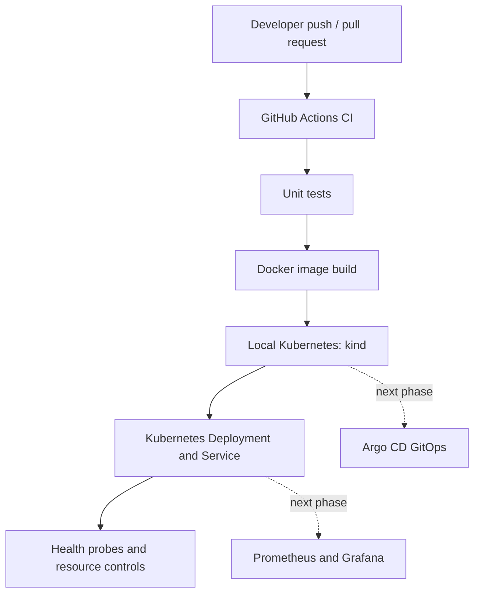

# Cloud-Native GitOps Platform

A local-first DevOps portfolio project demonstrating containerization, automated testing, Kubernetes deployment, GitOps delivery, and application observability. The project is designed to run locally without creating cloud resources.

## Architecture



## Technology stack

- Python + FastAPI application
- Docker container image running as a non-root user
- GitHub Actions for continuous integration
- kind for a local Kubernetes cluster
- Kubernetes Deployment, Service, readiness/liveness probes and resource limits
- Prometheus-compatible application metrics
- Planned next phase: Argo CD, Prometheus/Grafana stack, image scanning and policy checks

## Prerequisites

- Git
- Python 3.12+
- Docker Desktop with Linux containers enabled
- `kubectl`
- `kind`

On Windows, Docker Desktop's WSL 2 backend is a practical default. Check the official installation documentation and verify your computer meets its requirements.

## Run the app locally

```bash
python -m venv .venv
# Windows PowerShell:
.\.venv\Scripts\Activate.ps1
# macOS/Linux:
# source .venv/bin/activate

python -m pip install -r requirements-dev.txt
python -m pytest -q
uvicorn app.main:app --reload
```

Open `http://127.0.0.1:8000/`, `http://127.0.0.1:8000/health/live`, `http://127.0.0.1:8000/health/ready`, and `http://127.0.0.1:8000/metrics`.

## Build and run with Docker

```bash
docker build -t platform-demo:local .
docker run --rm -p 8000:8000 platform-demo:local
```

Then visit `http://127.0.0.1:8000/`.

## Deploy to local Kubernetes

Create the cluster:

```bash
kind create cluster --name platform-lab --config kind/cluster.yaml
```

Build the image and load it into kind (kind uses its own node image cache):

```bash
docker build -t platform-demo:local .
kind load docker-image platform-demo:local --name platform-lab
kubectl apply -k k8s/overlays/local
kubectl rollout status deployment/platform-demo -n platform-demo
kubectl get pods,svc -n platform-demo
```

Forward the service to your PC:

```bash
kubectl port-forward -n platform-demo service/platform-demo 8000:80
```

Visit `http://127.0.0.1:8000/`.

## Troubleshooting

- **ImagePullBackOff:** confirm you built and loaded the image into the correct kind cluster.
- **CrashLoopBackOff:** inspect `kubectl logs -n platform-demo deploy/platform-demo` and `kubectl describe pod -n platform-demo <pod-name>`.
- **Readiness probe failing:** test the `/health/ready` endpoint and inspect pod events.
- **Port already in use:** choose another local port, e.g. `kubectl port-forward -n platform-demo service/platform-demo 8081:80`.

## CI workflow

GitHub Actions runs on pushes and pull requests targeting `main`. It installs Python dependencies, runs tests and builds the Docker image. The initial workflow intentionally does not publish an image or deploy to a cluster: GitHub-hosted runners cannot directly reach your local PC's Kubernetes cluster.

## Roadmap

- [x] FastAPI application with health endpoints and Prometheus metrics
- [x] Dockerfile with non-root user and health check
- [x] Unit tests and GitHub Actions CI
- [x] Kubernetes manifests with probes, resource controls and security context
- [ ] Add image vulnerability scanning and dependency/security checks
- [ ] Install Argo CD and define an Application resource
- [ ] Add Prometheus and Grafana dashboards
- [ ] Add failure-injection exercises and incident runbooks
- [ ] Add screenshots and a short demo recording

## Cleanup

```bash
kubectl delete -k k8s/overlays/local
kind delete cluster --name platform-lab
```

## Security notes

Do not commit passwords, tokens, kubeconfig files, `.env` files or private keys. The local Kubernetes manifests are a learning baseline, not a complete production security policy. Validate and harden them before production use.

## License

MIT — add a `LICENSE` file before publishing if you choose this license.


## Kubernetes Reliability Testing

The local Kubernetes deployment was validated with the following tests:

- Deployed two application replicas.
- Verified liveness and readiness health endpoints.
- Deleted a running pod to simulate an unexpected workload interruption.
- Confirmed that Kubernetes automatically created a replacement pod.
- Verified that the deployment returned to `2/2` ready replicas.
- Confirmed that the application health endpoints remained accessible through the Kubernetes Service.

### Recovery Verification

The deleted pod was replaced automatically by Kubernetes, and the replacement became Ready. The Deployment returned to its desired state of two available replicas.

### Health Endpoints

- Liveness: `/health/live`
- Readiness: `/health/ready`
